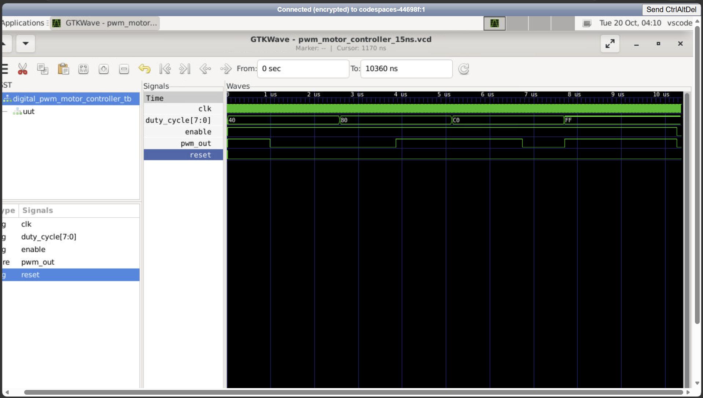
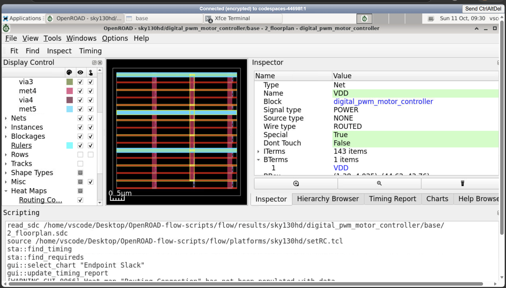
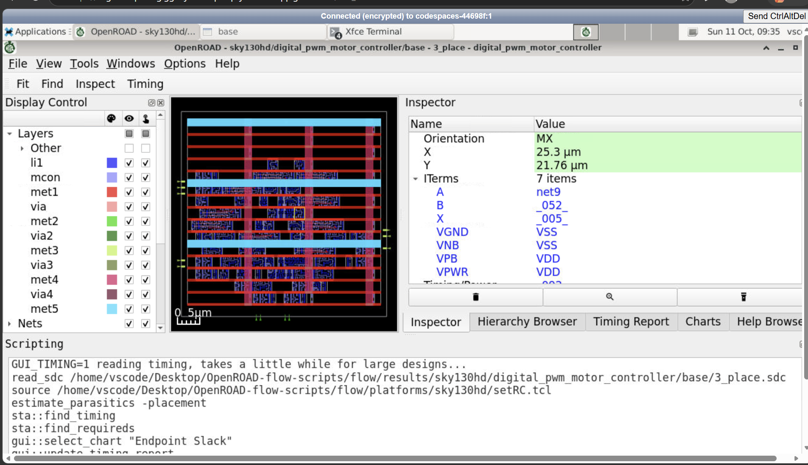
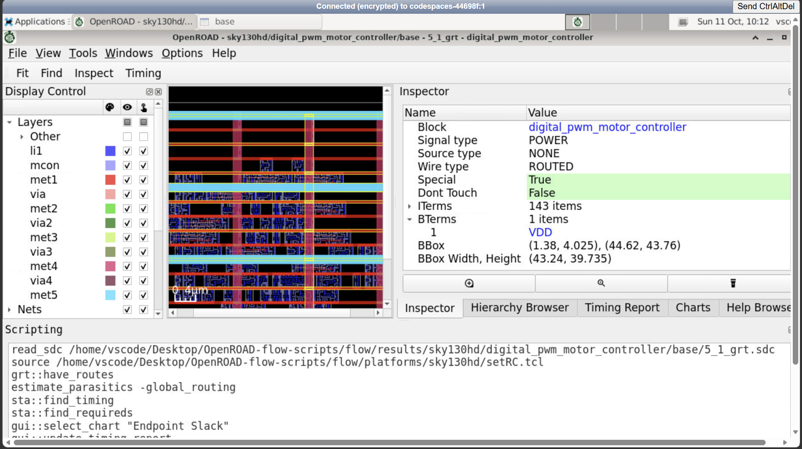
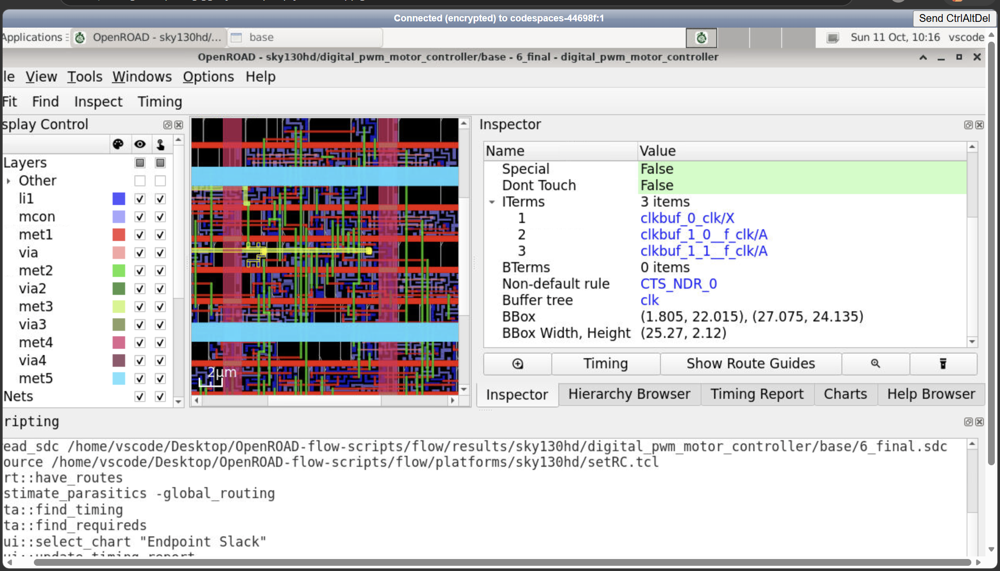
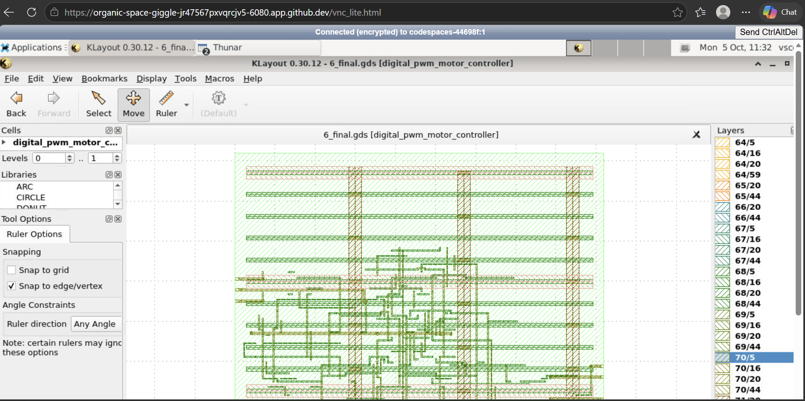
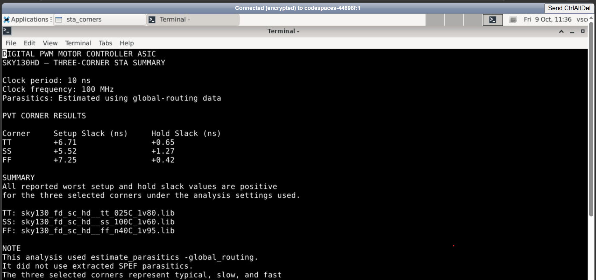

# Digital PWM Motor Controller — ASIC Implementation

**Verilog RTL | SKY130HD | OpenROAD | Physical Design | 16-Variant Static Timing Analysis**
## 1. Project Introduction

The **Digital PWM Motor Controller ASIC Implementation** project demonstrates the design and implementation of an 8-bit counter-based Pulse Width Modulation (PWM) controller using Verilog HDL.

The project explores the ASIC design flow using the SKY130HD standard-cell platform and OpenROAD-based implementation tools. It covers RTL design, functional simulation, synthesis, floorplanning, placement, clock tree synthesis (CTS), routing, final physical-design outputs, and Static Timing Analysis (STA).

The primary objective is to understand how a digital hardware design progresses from Verilog RTL to a physically implemented ASIC layout and how its timing performance can be evaluated using implementation reports.

## 2. Problem Statement

Pulse Width Modulation is widely used in motor-control applications to regulate the average power delivered to a motor through an appropriate driver circuit.

Designing a PWM controller involves more than generating a digital waveform. The digital logic must also be verified, synthesized into standard cells, physically implemented, and checked against its timing constraints.

The problem addressed in this project is:

**To design and simulate an 8-bit counter-based digital PWM controller using Verilog HDL, implement it through an ASIC design flow targeting SKY130HD, and evaluate its timing performance using Static Timing Analysis.**

This project focuses on the digital controller and its ASIC implementation workflow. It does not claim physical motor testing or fabricated-silicon validation.

## 3. Project Objectives

The main objectives are:

- Design an 8-bit counter-based PWM controller using Verilog HDL.
- Develop a testbench to verify the digital design through simulation.
- Configure the design for the SKY130HD standard-cell platform.
- Apply timing constraints using Synopsys Design Constraints (SDC) format.
- Execute synthesis and physical-design stages using an OpenROAD-based flow.
- Examine implementation evidence from floorplanning, placement, CTS, and routing.
- Evaluate setup and hold timing through Static Timing Analysis.
- Analyze the supplied results for 16 selected PVT timing variants under a 15 ns clock-period experiment.
- Preserve the source code, reports, logs, screenshots, and physical-design outputs in a GitHub repository.

## 4. PWM Fundamentals

PWM stands for **Pulse Width Modulation**. It controls the average power delivered to a load by switching a digital signal between HIGH and LOW states.

Three important PWM parameters are frequency, period, and duty cycle.

- **Frequency:** The number of complete PWM cycles per second.
- **Period:** The time required for one complete PWM cycle.
- **Duty cycle:** The percentage of a PWM period during which the output remains HIGH.

The duty cycle is calculated using:

\[
D=\frac{T_{\mathrm{ON}}}{T_{\mathrm{PERIOD}}}\times100\%
\]

For example:

| Duty cycle | HIGH time | LOW time |
|---|---:|---:|
| 25% | 25% of the period | 75% of the period |
| 50% | 50% of the period | 50% of the period |
| 75% | 75% of the period | 25% of the period |

By changing the duty cycle, the controller changes the PWM waveform's average value. In a practical motor-control system, a suitable motor driver and power stage are required to deliver the electrical power needed by the motor.

## 5. System Architecture and Operation

The project follows a digital RTL-to-ASIC implementation workflow.

The main stages are:

1. **RTL design:** Describe the PWM controller in Verilog HDL.
2. **Functional simulation:** Use a testbench to exercise the RTL and inspect its output waveform.
3. **Synthesis:** Convert the RTL into a gate-level netlist using the target standard-cell library.
4. **Floorplanning:** Establish the physical design area and basic implementation structure.
5. **Placement:** Assign physical locations to the standard cells.
6. **Clock Tree Synthesis:** Build the clock distribution network for the implemented design.
7. **Routing:** Create the interconnections between standard cells.
8. **Timing analysis:** Evaluate setup and hold timing against the applicable constraints.
9. **Final outputs:** Preserve the final layout, database, parasitic information, and netlist.

These stages connect the logical description of the controller to its physical implementation.

## 6. RTL Design and Functional Simulation

The main RTL source file is:

`digital_pwm_motor_controller/digital_pwm_motor_controller.v`

The simulation testbench is:

`additional_evidence/digital_pwm_motor_controller_tb.v`

The RTL describes the digital PWM controller, while the testbench provides the simulation environment used to examine its behavior.

Functional simulation helps identify logical errors before the design proceeds to synthesis and physical implementation. The resulting waveform can be inspected using GTKWave.

### Simulation waveform

**What this demonstrates:** The screenshot provides visual evidence from the simulation workflow. The clock, reset, PWM output, and other signals should be identified according to the signals actually displayed in the waveform.

## 7. ASIC Implementation Using SKY130HD and OpenROAD

The physical-design flow targets the SKY130HD standard-cell platform.

The main configuration file is:

`designs/sky130hd/digital_pwm_motor_controller/config.mk`

The baseline timing constraints are defined in:

`designs/sky130hd/digital_pwm_motor_controller/sdc/constraint.sdc`

The separate 15 ns experimental timing constraint is:

`designs/sky130hd/digital_pwm_motor_controller/sdc/constraint_15ns.sdc`

The implementation workflow includes synthesis, floorplanning, placement, clock tree synthesis, routing, and final physical-design output generation.

### Floorplan

The floorplan view provides evidence of the initial physical organization of the design.

### Global placement

The placement view shows the physical arrangement of the standard cells during the implementation flow.

### Global routing

The global-routing view provides evidence of the routing stage, where interconnect paths are planned across the design.

### Final physical layout

The final layout view illustrates the physically implemented design.

### Final GDS layout

The repository includes a final GDSII layout output. GDSII represents the geometric layout used in semiconductor implementation workflows. Generating this file does not, by itself, establish that a chip has been fabricated or tested in silicon.

## 8. Static Timing Analysis

Static Timing Analysis (STA) evaluates whether signal paths meet the timing requirements defined by the design constraints and timing libraries.

Two important timing checks are setup and hold.

- **Setup timing:** Checks whether data arrives sufficiently early before the receiving register's active clock edge.
- **Hold timing:** Checks whether data remains stable for the required interval after that clock edge.

Slack indicates the timing margin for a particular check. Positive slack indicates that the corresponding analyzed path meets the timing requirement under the reported conditions. Negative slack indicates a timing violation.

### 8.1 The 15 ns timing experiment

This project includes a 15 ns clock-period timing experiment covering 16 selected PVT variants.

PVT refers to process, voltage, and temperature conditions that can affect circuit timing. The supplied timing evidence contains per-variant logs and scripts, along with a summary and CSV table.

The following results are recorded in the supplied project evidence:

| Timing metric | Reported result |
|---|---:|
| Clock-period constraint | 15 ns |
| Selected timing variants | 16 |
| Worst setup slack | +1.86 ns |
| Worst hold slack | +0.39 ns |
| Total Negative Slack (TNS) | 0 |

The reported results indicate positive worst-case setup and hold slack for the 16 variants included in the supplied summary. The reported TNS is zero.

These values describe the supplied evidence; they are not presented as an independently rerun or foundry-signed-off result.

### 8.2 Timing analysis screenshots

The summary screenshot provides a visual overview of the timing-analysis evidence.

The post-route timing screenshot provides additional evidence of the reported timing analysis.

### 8.3 Detailed STA evidence

The principal 15 ns timing evidence is stored in:

- `reports/sky130hd/digital_pwm_motor_controller/sta_16_variants_15ns/`
- `reports/sky130hd/digital_pwm_motor_controller/STA_16_Variants_15ns_Summary.txt`
- `reports/sky130hd/digital_pwm_motor_controller/STA_16_Variants_15ns_Table.csv`

The separate `sta_16_variants/` directory contains earlier or baseline comparison evidence. It should not be confused with the dedicated `sta_16_variants_15ns/` experiment.

The detailed logs and CSV summary are the primary sources for the numerical timing results. Screenshots serve as supporting visual evidence.

## 9. Final Physical-Design Outputs

The final implementation outputs are located in:

`results/sky130hd/digital_pwm_motor_controller/base/`

Important files include:

| File | Purpose |
|---|---|
| `6_final.gds` | Final GDSII layout output |
| `6_final.odb` | Final OpenROAD database |
| `6_final.spef` | Extracted parasitic information |
| `6_final.v` | Final gate-level netlist |

These files represent different forms of implementation data.

The GDSII file contains the physical layout representation. The OpenROAD database stores physical-design information. The SPEF file records extracted parasitic information, and the final Verilog netlist describes the implemented gate-level connectivity.

Together, these artifacts help document the transition from RTL design to physical implementation.

## 10. Results and Limitations

The main outcomes of the project are:

- An 8-bit counter-based PWM controller described in Verilog HDL.
- A testbench and simulation evidence.
- SKY130HD flow configuration and timing constraints.
- Physical-design evidence covering the implementation stages.
- Final physical-design artifacts, including GDSII, ODB, SPEF, and Verilog netlist files.
- A supplied 15 ns STA experiment covering 16 selected timing variants.
- Recorded worst setup slack of +1.86 ns, worst hold slack of +0.39 ns, and TNS of zero in the supplied summary.

The results are limited to the configurations, constraints, libraries, and reports included in this repository. The package does not claim an independent rerun, foundry sign-off, fabrication, or physical motor testing.

The complete OpenROAD-flow-scripts installation and SKY130 platform libraries are not bundled. Reproducing the implementation flow requires a compatible external OpenROAD setup and the necessary platform files.

## 11. Future Improvements

Potential improvements include:

- Extend the testbench to cover more reset, counter, and PWM-output scenarios.
- Evaluate different clock periods and PWM configurations.
- Perform additional timing analysis under clearly documented constraints and PVT conditions.
- Compare implementation area, timing, and power using consistent reports.
- Investigate further RTL and physical-design optimizations.
- Integrate the controller with a suitable motor driver and evaluate the complete system on hardware.

These improvements would extend the project from digital ASIC implementation toward broader system-level validation.

## 12. Conclusion

The Digital PWM Motor Controller ASIC Implementation project demonstrates the use of Verilog HDL and an open-source ASIC design flow to develop and implement a digital PWM controller.

The work covers RTL design, functional simulation, synthesis, floorplanning, placement, clock tree synthesis, routing, final layout generation, and Static Timing Analysis.

The supplied 15 ns timing evidence records positive worst-case setup and hold slack across the 16 included variants, with zero reported TNS. These results provide a documented basis for discussing the timing behavior of the implementation under the reported conditions.

The project provides practical experience with the connection between digital logic design and physical ASIC implementation.

## 13. Repository Structure and Important Files

| Path | Description |
|---|---|
| `digital_pwm_motor_controller/digital_pwm_motor_controller.v` | Main RTL |
| `additional_evidence/digital_pwm_motor_controller_tb.v` | Simulation testbench |
| `designs/sky130hd/digital_pwm_motor_controller/config.mk` | SKY130HD design configuration |
| `designs/sky130hd/digital_pwm_motor_controller/sdc/constraint.sdc` | Baseline timing constraint |
| `designs/sky130hd/digital_pwm_motor_controller/sdc/constraint_15ns.sdc` | 15 ns experimental constraint |
| `reports/sky130hd/digital_pwm_motor_controller/sta_16_variants_15ns/` | Per-variant STA logs and scripts |
| `reports/sky130hd/digital_pwm_motor_controller/STA_16_Variants_15ns_Summary.txt` | Timing summary |
| `reports/sky130hd/digital_pwm_motor_controller/STA_16_Variants_15ns_Table.csv` | Tabular timing results |
| `results/sky130hd/digital_pwm_motor_controller/base/6_final.gds` | Final GDSII layout |
| `results/sky130hd/digital_pwm_motor_controller/base/6_final.odb` | Final OpenROAD database |
| `results/sky130hd/digital_pwm_motor_controller/base/6_final.spef` | Extracted parasitics |
| `results/sky130hd/digital_pwm_motor_controller/base/6_final.v` | Final netlist |

The `outputs/` directory contains screenshots from the project workflow, while `logs/` and `reports/` preserve implementation and timing evidence.

